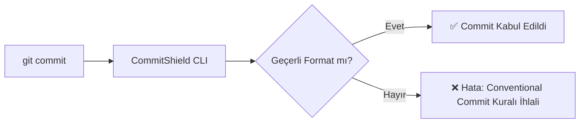

# 57. Building a Standout AI-Enhanced Portfolio & Open Source Contributions

**Retiring Generic Todo Apps and Building Production-Grade Open Source Impact**  
*Module 10 • Difficulty Level: Intermediate / Advanced • Estimated Reading Time: 12 min*

---

> ### 🎙️ NotebookLM & Audio Overview Podcast Briefing
> **Podcast Discussion Hook:**  
> *"Why do tech hiring leads discard resumes showing 10 generic tutorial clones, and how does a single impactful open-source contribution land interview offers?"*  
> 
> **3 Core Audio Takeaways:**  
> - 📌 Tutorial clones (generic todo apps, basic calculator apps) convey zero engineering credibility to hiring managers.
- 📌 A standout portfolio showcases: one deployed, production-grade application solving a real domain problem with automated tests and CI/CD.
- 📌 AI tooling accelerates open-source impact: digest unfamiliar repositories, reproduce community issues, and author upstream Pull Requests.

---

## 📖 1. The Story & Real-World Analogy

Visit an art gallery.

Hanging on the wall are 50 generic paint-by-numbers coloring book pages: color 1 blue, color 2 green. Would you invite that painter to exhibit at the Louvre? Never. They merely filled in someone else's contours (Tutorial Hell).

Yet in the corner hangs a single original canvas with textured brushwork, authentic perspective, and meticulous framing. It commands the entire room.

Your GitHub profile is that gallery.
Twenty abandoned YouTube tutorial clones signal mediocrity. A single deployed, well-documented open-source utility solving an authentic developer friction point commands immediate respect from tech leads.

---

## 🧠 2. The AI Mental Model & Paradigm Shift

The Standout Portfolio Anatomy:

```
┌────────────────────────────────────────────────────────┐
│           ANATOMY OF A COMPELLING PORTFOLIO            │
└──────────────────────────┬─────────────────────────────┘
                           │
  1. REAL-WORLD UTILITY: Solves authentic friction (e.g., automated schema linting).
  2. LIVE PRODUCTION ARTIFACT: Deployed URL or published npm/pip package.
  3. REGRESSION RIGOR: Robust test suite accompanied by a passing CI build badge.
  4. STELLAR DOCUMENTATION: Architectural Mermaid diagram, quickstart, demo GIF.
  5. DISCIPLINED GIT TRAIL: Conventional commits demonstrating iterative maturity.
```

---

## 🤖 3. AI Prompt Lab (Production-Ready Templates)

You can directly paste and adapt this prompt template in Cursor, Claude Code, ChatGPT, or Copilot:

```markdown
# ROLE: Open Source Maintainer & Career Strategist
We are launching an open-source CLI utility: a linter validating Git commit messages against the Conventional Commits specification.

## TASK:
1. Author a world-class `README.md` featuring build badges, quickstart docs, and a Mermaid flow diagram.
2. Provide a tactical workflow for triaging and resolving 'Good First Issue' tickets across major open-source repositories via AI.
3. Formulate the technical narrative highlighting architectural decisions for interviews.
```

---

## 💻 4. Code Walkthrough: Naive / Hallucination vs. Production-Grade

#### ❌ Naive / Unchecked AI Output (Risky):
```markdown
# commit-linter
Bu proje commitleri kontrol eder.
Kurmak icin npm install yazin.
```

#### ✅ Senior-Refined Version (Robust & Clean):
```markdown
# 🛡️ CommitShield: Intelligent Conventional Commit Linter

[](https://github.com)
[](https://badge.fury.io/js/commit-shield)
[](https://opensource.org/licenses/MIT)

**CommitShield**, Git commit mesajlarınızı Conventional Commits standartlarına göre AST seviyesinde denetleyen, hafif ve sıfır bağımlılıklı bir CLI aracıdır.

---

## ⚡ Hızlı Kurulum

```bash
# Global Kurulum
npm install -g commit-shield

# Git Pre-commit Hook Olarak Ekleme
commit-shield install-hook
```

---

## 🏗️ Mimari Akış Şeması



---

## 🧪 Testler ve Doğrulama
```bash
npm test -- --coverage # %98 Birim Test Kapsamı
```
```

**💡 Code Analysis:**
A repository presenting automated CI badges, interactive Mermaid architecture diagrams, and comprehensive quickstart instructions stands out in the top 1% of applicant pools.

---

## ⚠️ 5. Junior Pitfalls & Senior Perspective

- **Trap:** Pinning unfinished, unmaintained tutorial repositories on your public GitHub profile.
  - **Remedy:** Curate your profile: showcase 2 or 3 polished, deployed, and tested flagships.
- **Trap:** Neglecting repository README documentation.
  - **Remedy:** The README is your resume's landing page: include visual demos, architecture diagrams, and test badges.
- **Trap:** Limiting open-source contributions to trivial typo fixes in markdown files.
  - **Remedy:** Tackle 'Good First Issue' defects containing test assertions to demonstrate real engineering capability.

---

## 🎬 6. Udemy Video Lecture Blueprint & Slide Deck

### 🎥 Lecture Title: *Lecture 57: Standout Portfolios & Open Source Contributions*
- 🖥️ **Slide 1:** Why generic tutorial clones destroy applicant credibility.
- 🖥️ **Slide 2:** The 5 structural pillars of a high-impact GitHub portfolio.
- 🖥️ **Slide 3:** Leveraging AI to parse issues and author your first upstream open-source PR.
- 🖥️ **Slide 4:** Curating your engineering storefront: Stellar READMEs and diagrams.

**Live Coding / Screencast Scenario:**  
Navigate to a well-known open-source repository issue tracker. Filter by 'good-first-issue'. Use AI to dissect the issue description, replicate the bug locally, and scaffold a proposed fix.

---

## 🎯 7. Daily Action Task & Mini Quiz

### 🛠️ Daily Action Task:
Select your strongest personal project and overhaul its `README.md` with an architectural diagram, CI status badge, and clear local quickstart steps.

### 🧠 Chapter Review Quiz:

**Question 1:** What portfolio signal most impresses an engineering hiring manager?
  - A) 100 half-finished tutorial forks
  - B) 1 or 2 polished, tested, and deployed applications solving authentic problems with passing CI checks and disciplined git commits
  - C) AI-generated avatar pictures
  - D) Raw green commit contribution counts
> **Correct Answer:** B
> **Explanation:** Engineering managers evaluate quality over quantity: a single tested, deployed application proves production readiness far beyond fifty cloned projects.

**Question 2:** Which standard GitHub label denotes issues optimized for new open-source contributors?
  - A) `critical-emergency`
  - B) `good first issue` (or `help wanted`)
  - C) `wontfix`
  - D) `core-architecture-only`
> **Correct Answer:** B
> **Explanation:** `good first issue` flags isolated, well-specified problems curated by maintainers to onboard new community contributors.

