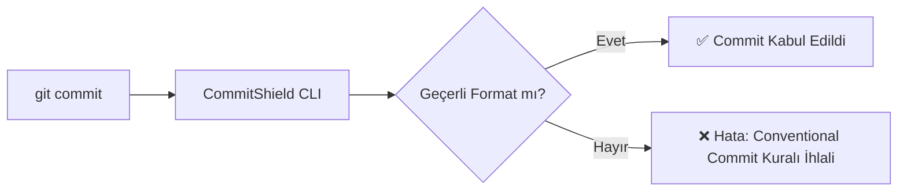

# 57. AI Araçlarıyla Portföy ve Açık Kaynak Projesi İnşa Etmek

**Sıradan 'To-Do App' Projelerini Çöpe Atıp Fark Yaratan İşler Üretmek**  
*Bölüm 10 • Zorluk Derecesi: Orta / İleri Seviye • Tahmini Okuma Süresi: 12 dk*

---

> ### 🎙️ NotebookLM & Audio Overview Podcast Notları
> **Podcast Tartışma Sorusu:**  
> *"İşe alım yöneticileri neden adayın GitHub'ında 10 tane yarım kalmış tutorial projesi görmekten bıktı ve tek bir gerçek açık kaynak katkısı nasıl iş teklifi getirir?"*  
> 
> **Bölümden Çıkarılacak 3 Altın Cümle:**  
> - 📌 Tutorial çöplüğü (Tutorial Hell) projeleri (To-Do list, basit klonlar) artık hiçbir şirketi etkilemiyor.
- 📌 İyi bir portföy projesi: Gerçek bir problemi çözen, canlıda çalışan (deployed), testleri olan ve temiz dokümante edilmiş tek bir projedir.
- 📌 AI araçları, popüler açık kaynak kütüphanelerindeki (open source) bekleyen hata biletlerini (Issues) analiz edip ilk PR'ınızı açmanızı 10 kat kolaylaştırır.

---

## 📖 1. Giriş Hikayesi & Günlük Hayat Analojisi

Bir resim sergisine gittiğinizi düşünün.

Duvarda 50 tane boyama kitabı sayfası asılı. Çocuklar numaralara göre boyamış: 1 mavi, 2 sarı... O ressamı Louvre Müzesi'ne davet eder misiniz? Asla! Çünkü o sadece başkasının çizgilerini doldurmuştur (Tutorial Hell).

Oysa köşede duran, orijinal, fırça darbeleri kendine has, çerçevesi özenle yapılmış tek bir tablo tüm sergiyi büyüler!

Yazılımda da GitHub profiliniz sizin resim serginizdir. 
YouTube'dan kopyalanmış 20 tane yarım 'Netflix Klonu' yerine; gerçek bir problemi çözen, Docker ile paketlenmiş, testleri yeşil yanan ve canlıda çalışan tek bir açık kaynak araç sizi yüzlerce adayın önüne geçirir.

---

## 🧠 2. AI Çağında Yeni Zihniyet Modeli

İşe Alım Yöneticisini Etkileyen Portföy Formülü:

```
┌────────────────────────────────────────────────────────┐
│               10x PORTFÖY PROJESİ FORMU                │
└──────────────────────────┬─────────────────────────────┘
                           │
  1. GERÇEK PROBLEM: "Geliştiricilerin .env dosyalarındaki eksikleri bulan CLI aracı"
  2. CANLI ÇALIŞMA: Tek tıkla çalışan demo veya npm/pip paketi.
  3. TEST KAPSAMI: Jest testleri ve yeşil yanan GitHub Actions CI rozeti.
  4. MÜKEMMEL README: Mimari şema (Mermaid), kurulum kılavuzu, GIF animasyonu.
  5. TEMİZ GİT GEÇMİŞİ: Conventional Commits standardında 30+ düzenli commit.
```

---

## 🤖 3. AI Prompt Laboratuvarı (Kopyala-Yapıştır Hazır Prompt)

Aşağıdaki prompt şablonunu Cursor, Claude Code, ChatGPT veya Copilot ortamınızda doğrudan kullanabilirsiniz:

```markdown
# ROL: Açık Kaynak Topluluk Lideri ve Portföy Danışmanı
GitHub'da açık kaynak bir CLI aracı yayınlayacağız. Proje: 'Git commit mesajlarını analiz edip Conventional Commits standartlarına uygunluğunu denetleyen linter'.

## GÖREV:
1. Bu proje için dünya standartlarında, rozetler (Badges) ve Mermaid diyagramı içeren bir `README.md` şablonu hazırla.
2. Açık kaynak projelere ilk katkıyı (First Contribution) yapmak için 'Good First Issue' etiketli biletleri AI ile nasıl çözeceğimi planla.
3. Bir iş görüşmesinde bu projeyi anlatırken öne çıkarılacak 3 mimari noktayı belirle.
```

---

## 💻 4. Kod İncelemesi: Acemi / Halüsinasyon vs. Üretim Kalitesi

#### ❌ Acemi / Kontrolsüz AI Çıktısı (Riskli):
```markdown
# commit-linter
Bu proje commitleri kontrol eder.
Kurmak icin npm install yazin.
```

#### ✅ Kıdemli Mühendis Tarafından İyileştirilmiş Sürüm (Güvenli & Temiz):
```markdown
# 🛡️ CommitShield: Intelligent Conventional Commit Linter

[](https://github.com)
[](https://badge.fury.io/js/commit-shield)
[](https://opensource.org/licenses/MIT)

**CommitShield**, Git commit mesajlarınızı Conventional Commits standartlarına göre AST seviyesinde denetleyen, hafif ve sıfır bağımlılıklı bir CLI aracıdır.

---

## ⚡ Hızlı Kurulum

```bash
# Global Kurulum
npm install -g commit-shield

# Git Pre-commit Hook Olarak Ekleme
commit-shield install-hook
```

---

## 🏗️ Mimari Akış Şeması



---

## 🧪 Testler ve Doğrulama
```bash
npm test -- --coverage # %98 Birim Test Kapsamı
```
```

**💡 Kod Analizi:**
Böyle bir README, CI rozetleri ve Mermaid şeması gören bir işe alım lideri adayın kodlama kalitesinden ve profesyonelliğinden anında emin olur.

---

## ⚠️ 5. Junior Tuzakları & Kıdemli Bakış Açısı

- **Tuzak:** GitHub'da sadece ödev veya YouTube klon projeleri barındırmak.
  - **Çözüm:** Profilinizi temizleyin; sadece gurur duyduğunuz en iyi 2-3 projeyi 'Pinned' (Sabitlenmiş) yapın.
- **Tuzak:** README dosyası olmayan veya sadece 'Proje Başlığı' yazan boş repolar bırakmak.
  - **Çözüm:** README projenizin vitrinidir; ekran görüntüleri, kurulum adımları ve test rozetleri ekleyin.
- **Tuzak:** Açık kaynak projelere sadece dokümantasyondaki bir harf hatasını düzelterek katkı yapmaya çalışmak.
  - **Çözüm:** 'Good First Issue' etiketli gerçek bir bug'ı testleriyle birlikte çözerek değer üretin.

---

## 🎬 6. Udemy Video Dersi Taslağı & Slayt Maddeleri

### 🎥 Ders Başlığı: *Ders 57: Portföy ve Açık Kaynak - Fark Yaratan Mühendis Olmak*
- 🖥️ **Slayt 1:** Neden 'To-Do App' projeleri artık kimseyi etkilemiyor?
- 🖥️ **Slayt 2:** Mükemmel bir GitHub portföyünün 5 bileşeni.
- 🖥️ **Slayt 3:** AI kullanarak açık kaynak projelere ilk PR'ı açma kılavuzu.
- 🖥️ **Slayt 4:** Vitrin oluşturma: Mükemmel README ve mimari diyagramlar.

**Canlı Kodlama / Ekran Kaydı Senaryosu:**  
GitHub'da açık kaynaklı bir depodaki (örn: Express veya Fastify) bir 'Good First Issue' biletini açın. AI asistanına bu hatayı analiz ettirip test senaryosunu nasıl hazırlayacağınızı canlı gösterin.

---

## 🎯 7. Günün Uygulamalı Görevi & Mini Sınav

### 🛠️ Günün Görevi:
GitHub profilinizdeki en iyi projenizi seçin. Ona profesyonel bir `README.md`, rozetler (badges) ve bir Mermaid akış şeması ekleyin.

### 🧠 Bölüm Sonu Kontrol Testi:

**Soru 1:** İşe alım yapan bir teknoloji liderinin bir adayın GitHub profilinde en çok görmek istediği şey nedir?
  - A) 100 farklı yarım bırakılmış tutorial klonu
  - B) Gerçek bir problemi çözen, testleri olan, CI/CD boru hattı yeşil yanan ve canlıda çalışan 1-2 adet yüksek kaliteli proje
  - C) Profil resminin yapay zeka olması
  - D) Sadece yeşil commit kutuları
> **Doğru Yanıt:** B
> **Açıklama:** Kıdemli mühendisler niceliğe değil niteliğe bakar; canlıda çalışan ve testleri olan tek bir proje, 50 yarım klondan katbekat değerlidir.

**Soru 2:** Açık kaynak (Open Source) projelere yeni başlayan geliştiricilerin araması önerilen standart etiket hangisidir?
  - A) critical-emergency
  - B) good first issue (veya beginner-friendly)
  - C) do-not-touch
  - D) linux-kernel-only
> **Doğru Yanıt:** B
> **Açıklama:** `good first issue`, proje yöneticilerinin topluluğa yeni katılan geliştiricilerin kolayca çözebileceği şekilde etiketlediği başlangıç seviyesi biletlerdir.

